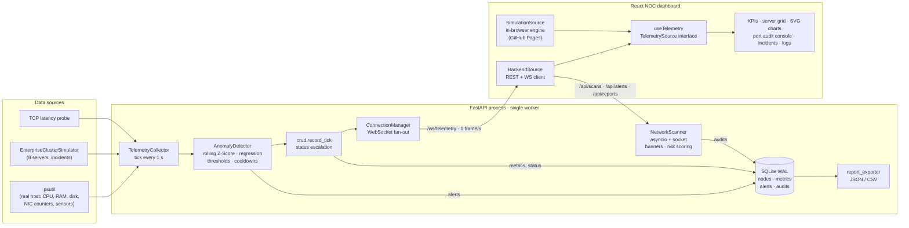

<div align="center">

# NetPulse SysGuard

**IT infrastructure monitoring, local network auditing and real-time anomaly detection — with a live NOC dashboard.**

[](https://dftii.github.io/netpulse-sysguard/)

[](https://github.com/dftii/netpulse-sysguard/actions/workflows/ci.yml)
[](https://github.com/dftii/netpulse-sysguard/actions/workflows/deploy.yml)
[](LICENSE)
<br />
[](backend/requirements.txt)
[](backend/app/main.py)
[](backend/app/database.py)
[](backend/tests)
[](frontend/package.json)
[](frontend/tsconfig.app.json)
[](frontend/vite.config.ts)
[](frontend/src/index.css)
[](docker-compose.yml)

</div>

NetPulse SysGuard collects **real hardware and network telemetry** from the host machine with `psutil`, augments it with a **simulated 8-server enterprise cluster**, streams everything over **WebSockets** every second, detects anomalies with **rolling Z-Score statistics and linear regression**, audits exposed TCP ports with a **risk classification engine**, and keeps a full incident history in **SQLite** for JSON/CSV technical reports. A React **Network Operations Center (NOC) dashboard** visualises it all in real time.

> **The live demo needs no server.** On GitHub Pages the dashboard detects that no backend is reachable and switches to an **in-browser simulation engine**: a TypeScript port of the backend's cluster simulator, Z-Score detector and port-risk catalogue. Metrics stream every second, you can launch simulated port audits, inject incidents and watch alerts fire. Run the backend locally and the same UI switches to **real telemetry**.

## Live demo vs. real telemetry

| | GitHub Pages demo | Local install |
|---|---|---|
| **Data** | Simulated 8-server enterprise cluster, generated in your browser | Your own machine's real `psutil` telemetry plus the simulated cluster |
| **Anomaly detection** | Same Z-Score / regression algorithm, ported to TypeScript | Python detector, alerts persisted in SQLite |
| **Port audits** | Simulated scans with realistic, deterministic results | Real asynchronous TCP scans of your private network |
| **Setup** | None, just open the link | `git clone` + `python run.py` + `npm run dev` ([Installation](#installation)) |

**Why the online demo is always simulated:** GitHub Pages only serves static files, so there is no Python process to run `psutil`. Real telemetry would also always describe the machine running the backend, not the visitor's computer. Browsers block an `https` page from calling a plain-`http` backend, so on Pages the dashboard skips the attempt and starts the simulation within a few hundred milliseconds. Pressing **Live backend** there only explains this in the log console.

To see **real data from your own computer**, follow [Installation](#installation) and open `http://localhost:5173`. The dashboard detects the local backend automatically and adds your machine as a ninth, non-simulated node.

## Dashboard tour

| Panel | What to look at |
|---|---|
| **Header** | Overall cluster status (NOMINAL / ATTENTION / DEGRADED), data source selector, **Export report** (JSON snapshot of the cluster and its anomalies) and four KPIs: average uptime, total bandwidth, healthy vs. critical nodes and open alerts. |
| **Infrastructure nodes** | One card per server, with CPU, RAM, NVMe storage, temperature and latency bars coloured green / amber / red by threshold. Values move every second, as real load does. Click a card to focus the charts on that server. |
| **Network traffic / CPU load** | Native SVG charts of the last 120 seconds, for the whole cluster or for the selected server. |
| **Port audit console** | Choose a server or IP and launch a scan. You get its open ports, services, risk levels and the remediation advice for each finding. |
| **Incidents** | Anomalies the detector found by itself, each with the observed value, threshold and baseline. Use **Inject incident** (e.g. *Service down* on `web-app-01`) to trigger a failure and watch the card, the alert and the log react. |
| **Log console** | A `journalctl`-style live feed of alerts, status changes, scans and operator actions. |

In day-to-day operation only the status pill and the incident panel need attention. The rest of the screen is there to investigate when something turns red.

## Features

| Area | What it does |
|---|---|
| **Telemetry** | Real host CPU, RAM, disk, network throughput, temperatures and TCP latency via `psutil`, plus 8 simulated enterprise servers with diurnal load curves, mean-reverting noise and bursts. |
| **Anomaly detection** | Rolling Z-Score per node and metric, least-squares memory-leak detection, absolute thresholds, baseline freezing and per-type cooldowns. Seven anomaly types. |
| **Port auditing** | Async TCP connect scan with bounded concurrency, banner grabbing, version-based risk escalation (e.g. vsFTPd 2.3.4) and remediation advice for 44 common services. |
| **Streaming** | One `TelemetryBroadcast` frame per second over `/ws/telemetry`, with concurrent fan-out and slow-client eviction. |
| **History & reports** | SQLite (WAL) storage for metrics, alerts and audits, with JSON/CSV exports and retention. |
| **NOC dashboard** | KPIs, live server grid with threshold-coloured bars, native SVG real-time charts, terminal-style port audit console, incident panel and a live `journalctl`-style log console. |
| **Ops** | Idempotent 24 h demo seeder, Docker image (non-root, healthcheck), CI and GitHub Pages deployment. |

## Architecture



Pipeline per tick: `collector.collect()` → `detector.analyze_and_persist()` → status escalation → `crud.record_tick()` → `ws_manager.broadcast()`.

## Anomaly detection algorithm

For every node and metric the detector keeps a **rolling window** (default `W = 60` samples) and maintains its mean and variance in **O(1)** per sample with Welford's algorithm extended with sample removal (periodically recomputed exactly to cancel floating-point drift).

Each new value `x` is scored **before** it joins the baseline, so an anomaly never inflates the statistics it is judged against:

$$z = \frac{x - \mu_{W}}{\sigma_{W}}$$

A reading is a statistical outlier when `z ≥ 3` (configurable) once at least 20 samples exist. A z-score says *unusual for this node*, not *dangerous*, so an outlier only alerts when the value is also high in absolute terms and well above the baseline, and on its own it is never more than a WARNING. CRITICAL is reserved for absolute limits. Live 1 Hz telemetry is bursty, so CPU outliers must also **persist for 10 consecutive samples**: a 5-second workload burst is normal, a runaway process is not. Against the simulated cluster with incidents disabled, these rules bring false alarms down from one every 28 s to zero in 8 simulated cluster-hours, while every injected incident type is still detected. While a metric stays anomalous its samples are **withheld from the baseline** (baseline freezing); if the condition outlasts the window, it is accepted as the new normal.

| Detector | Method |
|---|---|
| CPU spike | Z-Score outlier ≥ 70 % and 20 points above baseline, held 10 samples (WARNING), or sustained load ≥ 90 % for 3 samples (CRITICAL) |
| Memory leak | Least-squares slope and R² over a sliding window (slope ≥ 0.08 %/s, R² ≥ 0.85), with projected time to exhaustion |
| Bandwidth saturation | Full-duplex utilisation (busiest direction / NIC capacity) ≥ 85 %, plus Z-Score bursts ≥ 60 % and 15 points above baseline |
| Critical latency | Absolute limit (250 ms) plus a large jump relative to the baseline |
| Disk pressure | Absolute fill level (92 %) plus sudden jumps on an already full disk |
| Service down | Node OFFLINE for N consecutive samples; offline samples never touch the baselines |
| Thermal spike | Warning / critical limits (80 / 90 °C) plus Z-Score jumps ≥ 75 °C and 8 °C above baseline |

Cooldowns are applied per node and per anomaly type to prevent alert floods, but a WARNING can still escalate to CRITICAL during the cooldown. An alert stores the observed value, threshold, baseline mean/std and z-score, so every incident is explainable.

## Simulated enterprise cluster

| Hostname | Role | Profile |
|---|---|---|
| `db-primary-01` | Database | PostgreSQL 16, memory-heavy |
| `lb-edge-01` | Load balancer | HAProxy, network-heavy |
| `ai-gpu-node-01` | AI compute | Bursty CPU/RAM inference node |
| `fw-core-01` | Firewall | pfSense, high throughput |
| `web-app-01` | Web server | nginx application tier |
| `cache-redis-01` | Cache | Redis in-memory store |
| `nas-storage-01` | Storage | TrueNAS, high disk usage |
| `dc-ad-01` | Domain controller | Windows Server 2022 AD |

Normal operation never reaches critical values: only incidents do, whether random or injected through `POST /api/simulation/incidents` (or the dashboard's incident panel).

## Port auditing

The scanner runs an asynchronous TCP connect scan with bounded concurrency and classifies each port as open, closed (RST) or filtered (timeout). On open ports it grabs service banners and escalates the risk of outdated versions such as old OpenSSH or vsFTPd 2.3.4. Host latency is measured over TCP, with an ICMP fallback. Each of the 44 catalogued services has a risk level, a reason and a remediation recommendation, and the audit gets a 0–100 risk score. Only private, loopback and link-local targets are allowed by default (`NETPULSE_SCAN_ALLOW_PUBLIC_TARGETS=false`), and at most 2 scans run concurrently.

## Installation

### Prerequisites

- **Python 3.11+** (3.12–3.14 tested) for the backend.
- **Node.js 20.19+** (22 or 24 recommended) for the dashboard.
- Optional: **Docker** with Compose v2.

### 1. Clone

```bash
git clone https://github.com/dftii/netpulse-sysguard.git
cd netpulse-sysguard
```

### 2. Backend

```bash
cd backend
python -m venv .venv
.venv/Scripts/activate              # Linux/macOS: source .venv/bin/activate
pip install -r requirements-dev.txt
cp .env.example .env                # optional: tune NETPULSE_* settings
pytest                              # 225 tests
python seed.py                      # optional: 24 h demo dataset (--reset to rebuild)
python run.py                       # http://127.0.0.1:8000/docs
```

The seeder creates the same 8 servers as the simulator, 200 metric samples per server over the last 24 h, historical incidents of every type and port audits with critical findings. It is idempotent, and `--reset` only rebuilds the seeded servers' data.

### 3. Dashboard

In a second terminal:

```bash
cd frontend
npm install
npm run dev                         # http://localhost:5173
```

With the backend running, the dashboard connects to `http://127.0.0.1:8000` automatically. Without it, it starts the in-browser simulation. Switch at any time with the **Live backend / Demo simulation** selector in the header. Point to another backend with `VITE_API_BASE_URL` (see [frontend/.env.example](frontend/.env.example)).

Production build: `npm run build` (output in `frontend/dist`, served with `npm run preview`).

### 4. Docker (backend)

```bash
docker compose up -d --build                      # API on http://127.0.0.1:8000 (loopback only)
docker compose --profile seed run --rm seed       # optional: load the demo dataset
docker compose ps                                 # STATUS shows (healthy) once /api/health answers
```

The image is based on `python:3.12-slim`, runs as a non-root user, stores SQLite in the `netpulse-data` volume (`/app/data`) and checks `/api/health` with a `HEALTHCHECK`. It always runs a single uvicorn worker, because the telemetry pipeline, detector baselines and WebSocket clients live in process memory.

> **Telemetry inside a container.** `psutil` reads the kernel it runs on. Inside Docker the "host" node reports the container's view: its cgroup CPU/memory and, on Docker Desktop for Windows/macOS, the Linux VM, not your physical machine. Temperatures are usually unavailable. For real host telemetry, run natively with `python run.py`.

### 5. GitHub Pages

The [`deploy.yml`](.github/workflows/deploy.yml) workflow builds the dashboard with `VITE_DEFAULT_MODE=simulation` and publishes it on every push to `main` (or on demand from the Actions tab). Enable it once in **Settings → Pages → Build and deployment → Source: GitHub Actions**.

## API

| Method | Path | Description |
|---|---|---|
| WS | `/ws/telemetry` | Live `TelemetryBroadcast` frame every second (send `ping` to receive `pong`) |
| GET | `/api/health` | Service, database and pipeline health |
| GET | `/api/telemetry/latest` | Most recent snapshot of every node |
| GET | `/api/nodes` | Monitored nodes |
| GET | `/api/nodes/{id}` | Node detail |
| GET | `/api/nodes/{id}/metrics?minutes=60` | Historical metrics |
| GET | `/api/nodes/{id}/baseline` | Current detector baselines (mean / std per metric) |
| POST | `/api/scans` | Run a port audit `{ "target": "192.168.1.1", "ports": [22, 80], "port_range": [1, 1024] }` |
| GET | `/api/scans` | Audit history |
| GET | `/api/scans/{id}` | Audit detail with findings |
| GET | `/api/alerts` | Incident history (filters: `node_id`, `severity`, `anomaly_type`, `acknowledged`, `since`, `until`) |
| PATCH | `/api/alerts/{id}/acknowledge` | Acknowledge an incident |
| POST | `/api/simulation/incidents` | Inject an incident on a simulated node |
| GET | `/api/reports/incidents?format=json\|csv` | Incident report |
| GET | `/api/reports/metrics/{node_id}?hours=24&format=csv` | Metrics report |
| GET | `/api/reports/scans/{id}?format=json` | Port audit report |

Example: inject a memory leak and watch the detector catch it.

```bash
curl -X POST http://127.0.0.1:8000/api/simulation/incidents -H "Content-Type: application/json" -d "{\"hostname\": \"db-primary-01\", \"anomaly_type\": \"memory_leak\", \"duration_seconds\": 120}"
```

## Project layout

```
netpulse-sysguard/
├── backend/
│   ├── app/
│   │   ├── config.py                 # Pydantic Settings (NETPULSE_* env vars)
│   │   ├── enums.py                  # Shared domain enums
│   │   ├── database.py               # Async SQLAlchemy 2.0 engine, WAL SQLite
│   │   ├── models.py                 # ORM: Node, MetricSample, PortAudit, PortFinding, AnomalyAlert
│   │   ├── schemas.py                # Pydantic v2 API / stream contracts
│   │   ├── crud.py                   # Data-access layer
│   │   ├── ws_manager.py             # WebSocket fan-out with slow-client eviction
│   │   ├── main.py                   # FastAPI app, lifespan, pipeline, REST + WS endpoints
│   │   └── services/
│   │       ├── telemetry_collector.py  # psutil host source + enterprise cluster simulator
│   │       ├── network_scanner.py      # Async TCP port audit, banners, latency, risk scoring
│   │       ├── anomaly_detector.py     # Rolling Z-Score, leak regression, cooldowns
│   │       └── report_exporter.py      # JSON / CSV technical reports
│   ├── tests/                        # pytest suite (unit + end-to-end)
│   ├── run.py                        # Server entry point
│   ├── seed.py                       # Idempotent 24 h demo dataset seeder (--reset)
│   ├── Dockerfile                    # python:3.12-slim, non-root, healthcheck
│   └── .env.example
├── frontend/
│   ├── src/
│   │   ├── components/               # header, servers, charts, ui, scanner, incidents, console
│   │   ├── hooks/useTelemetry.ts     # source lifecycle, rolling history, alerts, logs
│   │   ├── services/                 # TelemetrySource contract, REST/WS client, mode resolver
│   │   │   └── simulation/           # in-browser cluster simulator, detector and scanner
│   │   ├── lib/                      # formatting and load thresholds
│   │   ├── types/                    # TypeScript mirror of the backend schemas
│   │   └── App.tsx                   # NOC dashboard layout
│   └── vite.config.ts
├── .github/workflows/                # CI and GitHub Pages deployment
├── docker-compose.yml
├── LICENSE
└── README.md
```

## Configuration

All backend settings use the `NETPULSE_` prefix. See [backend/.env.example](backend/.env.example) for the full list, which covers telemetry interval, retention, detector thresholds, scanner limits and CORS origins. The dashboard reads `VITE_API_BASE_URL` and `VITE_DEFAULT_MODE` (`auto`, `backend` or `simulation`).

## Tech stack

**Backend:** Python 3.11+ · FastAPI · WebSockets · Pydantic v2 · SQLAlchemy 2.0 (async) · SQLite (WAL) · psutil · asyncio/socket · pytest

**Frontend:** React 19 · TypeScript (strict) · Vite 8 · Tailwind CSS 4 · Lucide icons · native SVG charts (no chart library)

**Ops:** Docker · Docker Compose · GitHub Actions · GitHub Pages

## License

MIT. See [LICENSE](LICENSE).
